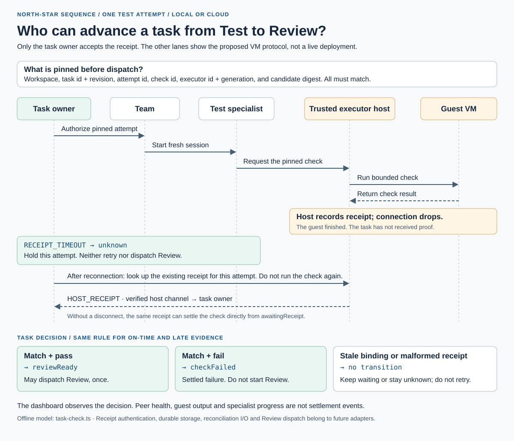

# Agent application DX: learning path

Start with **Actor Basics**, then follow the **SDLC** lessons in order. The
**Transport/UI** examples answer a different question: how to move or project
state without giving the transport or view workflow authority.

## Actor Basics

### Ping/Pong: behaviors only

Ping asks Pong when it receives `START`. Pong replies `PONG` when it receives
`PING`. Both rules live in `defineBehavior`. Spawn the two actors directly,
without a topology or a model.

```ts
import { createActorSystem, defineBehavior } from '@actor-web/runtime';

const system = await createActorSystem({ nodeAddress: 'localhost:0' });
await system.start();

try {
  const pong = await system.spawn(
    defineBehavior<{ type: 'PING' }>().onMessage(() => ({ reply: 'PONG' })),
    { id: 'pong' },
  );
  const ping = await system.spawn(
    defineBehavior<{ type: 'START' }>().onMessage(async () => ({
      reply: await pong.ask<'PONG'>({ type: 'PING' }),
    })),
    { id: 'ping' },
  );
  console.log(await ping.ask<'PONG'>({ type: 'START' })); // PONG
} finally {
  await system.stop();
}
```

The caller starts the exchange; Ping's behavior owns the handoff. A
[topology](../site/getting-started/topology-and-runtime.md) declares where stable
actors start. It does not decide how they respond.

## SDLC

### 1. Parallel SDLC Teams: assignments and orchestration

Run `pnpm examples:dev:local` from Actor-Web and open
[Parallel SDLC Teams](http://127.0.0.1:4173/parallel-sdlc-teams/).

1. **Publish definitions.** Open the registry entries to compare the reviewer
   revisions and their evidence grants. Publishing and revising are data-only.
2. **Allocate teams.** Checkout pins `reviewer@1`; Profile pins `reviewer@2`.
   The stable allocator starts two idle team actors from snapshots of the task
   revisions, definition revisions, and grants. Retirement then blocks new
   allocations that use the reviewer without changing either pin. No specialist
   sessions have opened yet.
3. **Run both teams.** Each team opens a new, single-use actor for each stage,
   with its own session address. Plan, Build, and Test produce typed facts.
   Review sees only its pinned, task-local evidence: v1 gets the Test record
   and candidate artifact; v2 gets the Test record alone. The scripted advisor
   is not a provider and does not own a transition. The team accepts a
   passing check and an advisory approval only for the pinned task revision
   and exact candidate, then produces a deterministic Document summary.

Select **Fail the checkout check** before running to inject a wrong checkout
candidate. Checkout stops at Test without calling Review; Profile still
finishes. The dashboard displays stage observations and team outcomes; it does
not accept evidence or move stages. **Reset** discards the local demo and starts
with an empty registry.

The [terminal demo](../../examples/parallel-sdlc-teams/demo.ts) uses the same
[scenario](../../examples/parallel-sdlc-teams/scenario.ts) and team behavior:
`pnpm examples:parallel-teams` or
`pnpm examples:parallel-teams --fail-checkout`. Both run in-process with no
credentials, provider calls, network transport, or workspace writes. The
example stops its local session actors and team actors; this does not establish
settlement of external work.

#### Test to Review: what if the receipt arrives late?

The browser and terminal demos let the **team** accept an in-process check.
A separate [offline FSM](../../examples/parallel-sdlc-teams/task-check.ts)
models how a **task owner** would decide whether one already-admitted Test
attempt can advance to Review when the check runs on a local or cloud VM.
`taskCheckBehavior(admitted)` pins the attempt in actor context and attaches
an XState machine with `withMachine()`. Its synchronous guards compare receipts
against that context; they do not perform I/O.

**Reading a held attempt (NS-03).** The original `withFSM()` constraint map
returned `unknown` to the timeout caller, but the public snapshot still showed
`active`. The machine-backed owner exposes the actual decision state in its
snapshot. Open `createActorReadModelSource(task)` *after* the timeout:
`snapshot().phase` and the first `subscribe()` callback both report `unknown`
with the pinned binding. Opening or reopening the source sends no task command
and starts no session. A later matching receipt updates the live source without
the reader replaying events. This proves late subscription to a running local
actor, not recovery after a process restart.



Read the diagram from top to bottom. The owner authorizes the team, the team
opens a Test session, and the specialist requests the check from the executor
host. The guest reports to the host, not to the task owner. If the host records
the result but disconnects before delivery, reconnecting means **look up the
existing receipt**, not **run the check again**. Peer health, session completion
and dashboard observations cannot advance the task.

| Current state | Event and condition | Next state |
| --- | --- | --- |
| `ready` | Owner sends `DISPATCH_CHECK` | `awaitingReceipt` |
| `awaitingReceipt` | `RECEIPT_TIMEOUT` names this `attemptId` | `unknown` (hold; no retry) |
| `awaitingReceipt` or `unknown` | `HOST_RECEIPT` matches; `passed` is `true` | `reviewReady` |
| `awaitingReceipt` or `unknown` | `HOST_RECEIPT` matches; `passed` is `false` | `checkFailed` |

The same receipt guard applies before and after timeout. It requires a boolean
`passed` and an exact match on `workspaceId`, `taskId`, `taskRevision`,
`attemptId`, `checkId`, `executorId`, `executorGeneration` and `candidateDigest`.
A receipt from a replaced executor therefore cannot settle the new attempt,
even if both ran the same candidate. A failed guard or an event not listed for
the current state returns `INVALID_TRANSITION` on `ask()` and leaves the state
unchanged. Both outcomes are terminal for this attempt, so a duplicate receipt
cannot settle it twice.

`reviewReady` means Review is permitted; the owner FSM itself neither starts a
reviewer nor launches a VM. Matching fields is not sender authentication.

**Opt-in team handoff (NS-04).** Instead of `app.runTeam(address)`, call
`app.beginAttempt(address, { workspaceId, executorId, executorGeneration })`
on an allocated team. It runs Plan and Build, pins the actual label bytes,
and opens a single Test session to prepare `EXECUTE_CHECK`. That session
closes and the call returns **before** a receipt exists. The successful result
contains the candidate, the execution request, the task owner's address for
observation, and a local `deliver(event)` method.

Deliver `RECEIPT_TIMEOUT` or `HOST_RECEIPT` through that method. The team
retains its candidate and forwards the event to its pinned owner. A timeout
leaves the attempt held; a matching failure ends the lane. Only the owner's
accepted pass produces the handoff that opens the pinned Review session.
The team refuses a caller-supplied `START_REVIEW` or a duplicate receipt;
neither starts work. The owner stays observable until `app.stop()`.
The [team tests](../../examples/parallel-sdlc-teams/team-attempt.test.ts)
drive these deliveries directly, without an executor or receipt store. The
default demo still checks the label itself and needs no deliveries.

Run the [transition tests](../../examples/parallel-sdlc-teams/task-check.test.ts)
from the repository root, without a VM or credentials:

```sh
pnpm exec vitest run --config examples/vitest.config.ts examples/parallel-sdlc-teams/task-check.test.ts
```

#### Sprint 1 acceptance: one held receipt, two independent teams

Run `pnpm examples:dev:local` and open the
[held-receipt dashboard](http://127.0.0.1:4173/parallel-sdlc-teams/held-receipt.html).
**Start a fresh run** opens the dashboard after Checkout times out and Profile
finishes. **Look up and deliver** releases Checkout's stored receipt; click
again to try a duplicate. Enable **Wrong Checkout label** before a fresh run
for the failure case. The original five-stage demo remains the default.

The [NS-05 fixture](../../examples/parallel-sdlc-teams/receipt-fixture.ts)
uses two in-process executor actors and scripted roles. Each executor holds
one admitted binding, a private copy of the candidate bytes and a receipt slot.
Lookup never runs the check, even on a miss. The dashboard reads each owner's
current decision, the executor's execution count, and the team's Review spawn
count and Document fact. It receives no command handles. These measurements
are for one task and attempt, not counts of deliveries or UI events.

1. Start `checkout@3` (local fixture, `reviewer@1`) and `profile@1` (cloud
   fixture, `reviewer@2`). Use a barrier to establish overlap: both teams must
   have started before either can finish.
2. Let Checkout execute and store a passing receipt. Withhold **delivery**,
   not execution. Signal the timeout for that attempt and keep the receipt held
   until Profile has reached Document. Checkout must still be `unknown`.
3. Open a fresh read-only dashboard. Its initial snapshot must show the held
   Checkout and completed Profile without issuing commands or changing counts.
   Deliver Profile's receipt and then a receipt from an older executor generation
   to Checkout. Neither may release it.
4. Look up Checkout's original receipt without executing the check. Deliver it,
   let Checkout reach Document, then deliver it again. The duplicate must not
   open a second Review session.

| Checkpoint | Checkout: checks / Review sessions | Profile: checks / Review sessions |
| --- | --- | --- |
| Profile finished; Checkout receipt still held | 1 / 0 | 1 / 1 |
| After dashboard mount and both refused receipts | 1 / 0 | 1 / 1 |
| After original receipt and duplicate | 1 / 1 | 1 / 1 |

**Negative control (fresh run):** inject the wrong Checkout label. Deliver its
matching failed receipt: Checkout must settle as `checkFailed`, with one check,
zero Review sessions and no Document. Profile must still reach Document. Keep
the [existing team test](../../examples/parallel-sdlc-teams/teams.test.ts)
green: in the default demo the same wrong label returns `CHECK_FAILED`.

To reproduce the positive, negative and executor-isolation checks headlessly:

```sh
pnpm exec vitest run --config examples/vitest.config.ts examples/parallel-sdlc-teams/receipt-fixture.test.ts
```

All actors and receipts here live in one process. This demonstrates independent
progress, not authenticated transport, durable recovery or real VM placement.

#### Messages between the task owner, team and executor

The [NS-02 contract](../../examples/parallel-sdlc-teams/check-protocol.ts)
defines these JSON messages for the opt-in workflow. It defines no transport,
artifact store, or VM operations. The original browser and terminal demos do
not send them.

| Message | Route | Meaning |
| --- | --- | --- |
| `EXECUTE_CHECK` | Test session → assigned executor | Run the check identified by the pinned `CheckBinding`, using the admitted task's `expectedLabel`. This is distinct from the owner's local `DISPATCH_CHECK` transition. |
| `LOOKUP_RECEIPT` | Task owner → assigned executor | Read the existing result for the same binding. Do not run the check, including on a miss. |
| `HOST_RECEIPT` / `RECEIPT_UNAVAILABLE` | Executor → task owner | Return the existing FSM receipt unchanged, or identify the requested binding with no result. Unavailable does not mean `passed: false` and cannot advance the task. |
| `START_REVIEW` | Task owner → pinned team | Hand off an accepted check to the team. `reviewHandoff()` takes the owner's `reviewReady` decision, not an executor's claim that the check passed. |

The artifact reference is the pair `(workspaceId, candidateDigest)` already in
`CheckBinding`. For this label fixture the bytes are the UTF-8 candidate label,
without an added newline. `pinCandidate()` hashes those bytes with SHA-256; the
executor resolves the reference in the admitted workspace and verifies the bytes
with `matchesCandidateBytes()` before checking. No host path or executable
callback crosses the boundary.

Dispatch, lookup and handoff carry `teamId` and the originating `testSessionId`
for tracing. The handoff ID is stable for the destination team and complete
check binding, including the executor generation. Redelivery must reuse this
ID; a new Test trace alone must not authorize another Review. The ID is not a
credential: authenticating the host and remembering which handoffs were
processed are separate integration tasks.

### 2. Portable Specialist: one bounded session

After building the workspace packages with `pnpm build`, run
`pnpm --filter @actor-web/example-portable-specialist demo`.
The [scripted CLI](../../examples/portable-specialist/demo.ts) drives one
source review and an in-memory read through one explicit grant. It teaches
the session boundary, not task allocation or stage orchestration. See the
[specialist execution contract](../specialist-execution-contract.md) for the
reusable execution baseline and its limits.

### 3. agent-starter Queue Board: operator policy

The [sibling board](../../../agent-starter/apps/board/README.md) is a separate
application. Stop the examples server before running `pnpm board:dev` from
agent-starter, then open its [operator console](http://127.0.0.1:4173/queue-board/).

- The operator edits the request, confirms checks, and reviews kickoff.
- The board owns admission, including dependencies, the ticket revision,
  and the current workflow lease. Its workflow issues one assignment at a
  time for the ticket, and specialists open in fresh purpose-specific sessions.
- Workers return results; the board validates them and owns stage
  transitions, recovery, and workspace policy. The console observes this state.

Document in Parallel SDLC Teams is a generated summary, not a board column.

## Transport/UI

- [Actor Workflow Dashboard](../../examples/fas-agent-loop/README.md) shows
  headless workflow projection and compares coordination styles. Its gateway,
  lattice, and projection fixtures are integration examples, not SDLC lessons.
- [Ignite Headless Host](ignite-element-host.md) projects Actor-Web snapshots
  and events into a UI.
- [Mesh Pong](../../examples/mesh-pong/ui/index.html) runs one topology across
  several transports. It is not the Ping/Pong message-passing prerequisite.

## Design note: proposed API names

`defineTopology`, `toolHandlers`, `reply.ok`, `reply.refuse`, `ActorResult`,
and `runtime.createClient` are design ideas, not the APIs used by these lessons.
Current examples use `defineActorWebTopology`, `startRuntime`, plain
`{ reply, context }` handler returns, and refs from the started runtime.
The [existing milestones](../todos.md) govern reusable specialist execution.
